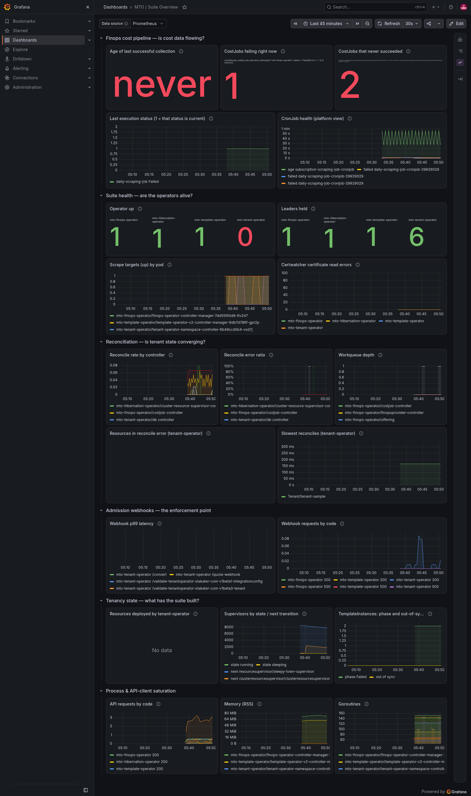

# mto-observability

Observability for the **Multi Tenant Operator (MTO)**: Prometheus monitors +
`PrometheusRule` alerts + a Grafana dashboard, integrated with OpenShift
user-workload monitoring (UWM) and the grafana-operator.

> **Status: 🔨 built, unreleased.** The chart ships headless scrape Services +
> ServiceMonitors + scraper RBAC for all four MTO operators, both alert tiers and
> the suite dashboard below,
> all behind a green [`tests/validate.sh`](tests/validate.sh). **Release stays gated**
> on (1) a live metrics capture re-verifying the scrape surface
> ([`tests/METRICS-CAPTURE.md`](tests/METRICS-CAPTURE.md)) and (2) the remaining
> roadmap decisions. Tier 1 (finops cost-pipeline alerts,
> [`docs/finops-alerts.md`](docs/finops-alerts.md)) additionally waits on operator
> releases carrying the state gauges. Scope is the **MTO suite of four operators** —
> tenant-operator, finops-operator (priority: silent cost-collection failure),
> hibernation-operator, template-operator-v2. MTO Console/Gateway are out of scope.

## Alerts (Tier 2 — rendered per enabled operator)

For each of the four operators (`<Op>` = TenantOperator / FinopsOperator /
HibernationOperator / TemplateOperator):

| Alert | Severity | Fires when |
| --- | --- | --- |
| `MTO<Op>Down` | critical | `up == 0` or the job is absent for 5m (needs `prometheus.monitors.serviceMonitors.enabled`) |
| `MTO<Op>ReconcileErrors` | warning | a controller's reconcile error ratio > 10% over 15m |
| `MTO<Op>WorkqueueBacklog` | warning | a workqueue holds > 50 items for 15m |
| `MTO<Op>WebhookErrors` | warning | an admission webhook returns 5xx for 10m |
| `MTO<Op>WebhookLatencyHigh` | warning | webhook p99 latency > 1s for 10m |

## Alerts (Tier 1 — the finops cost pipeline)

Built on the `finops_costjob_*` gauges (needs a finops-operator release carrying
them); the full spec and failure-shape matrix live in
[`docs/finops-alerts.md`](docs/finops-alerts.md):

| Alert | Severity | Fires when |
| --- | --- | --- |
| `MTOCostDataStale` | critical | no successful collection for `staleAfterSeconds` (default 2h) — the headline alert |
| `MTOCostJobNeverSucceeded` | critical | a CostJob exists but has never succeeded (30m grace) |
| `MTOCostJobFailing` | warning | last execution ended `Failed`/`Error` for 10m |
| `MTOFinopsMetricsAbsent` | warning | no `finops_costjob` series scraped at all — the watchdog |

Thresholds are placeholders until a live baseline; every one is a value under
`prometheus.rules.mto.*` / `prometheus.rules.finops.*`. Monitors default **off**;
enabling them creates one headless Service per controller deployment, one
ServiceMonitor per operator, and the scraper ServiceAccount/token bound to a
`GET /metrics` ClusterRole (the upstream pods declare no container ports and share
no common label, so chart-shipped Services are the only deterministic scrape).

## Live on the kind lab

The whole chart — monitors, 24 rules, dashboard — ran end-to-end on the capture
lab: 10/10 intended targets discovered, 8 up (two tenant components crash-loop on
missing optional CRDs there), and three alerts genuinely firing on real failures.



## Dashboard

One `GrafanaDashboard` CR, **MTO / Suite Overview** (folder from `grafana.folder`),
six sections: finops cost-pipeline freshness front and center (success age, failing /
never-succeeded counts, one-hot status, platform CronJob view), suite health
(up/leaders/certwatcher), reconciliation (rates, error ratio, workqueue, errored
resources, slowest reconciles), admission webhooks (p99, codes), tenancy state
(deployed resources, supervisor states and next transitions, TemplateInstance
phases/out-of-sync), and process/API saturation. Job labels are substituted from
`mto.operators.*.job`; gate on `grafana.dashboard.enabled`.

## Running only part of the suite

Each operator has its own switch: `mto.operators.<name>.enabled`. A cluster running
only finops-operator sets the other three to `false`
([docs/examples/values-finops-only.yaml](docs/examples/values-finops-only.yaml)) and
gets exactly the finops scrape surface and its nine alerts — no dead targets, no
absent()-alerts for operators that are not installed. The shared dashboard's panels
for absent operators read "No data"; disable it via `grafana.dashboard.enabled` if
unwanted.

## Prerequisites (planned surface)

- OpenShift with **user-workload monitoring** enabled
- **grafana-operator** (dashboards as `GrafanaDashboard` CRs)
- MTO ≥ 1.10 with its metrics endpoint enabled (`--metrics-bind-address`, on by
  default in OperatorHub installs) — the endpoint is authenticated HTTPS, so the
  scraper must hold a token bound to MTO's `metrics-reader` ClusterRole

## Development

```bash
helm template . -f values-local.yaml   # render check
./tests/validate.sh                    # full offline gate (meaningful once stories are built)
tilt up                                # live dev against the cluster in ../tilt-settings.json
tilt down -f Tiltfile-delete
```

Configuration tables, the alert table and the dashboard panel list are added here as
stories move to ✅ Done.
