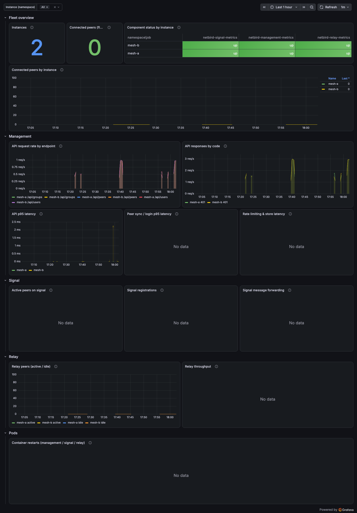
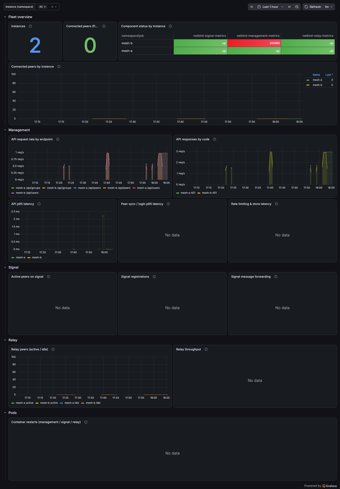

# netbird-observability

Observability for a **fleet of self-hosted NetBird instances** (management, signal, relay):
Grafana dashboard, Prometheus `ServiceMonitor`s and `PrometheusRule` alerts.

Built for the fleet model: **one NetBird instance per customer/organization, each in its own
namespace**, and this chart **installed once per instance namespace**. That layout is forced
by OpenShift user-workload monitoring's tenancy (ServiceMonitors only discover their own
namespace; ThanosRuler enforces the rule's namespace label of origin) — and it is also what
you want: every alert carries the instance's namespace, i.e. *whose mesh* is burning.
See [docs/roadmap.md](docs/roadmap.md) for the requirements this chart answers, story by
story, and [docs/runbook.md](docs/runbook.md) for what to do when an alert fires.

## Prerequisites

- A NetBird instance (management + signal + relay) in the install namespace. All three
  components expose `:9090/metrics` by default — **no NetBird configuration is needed**.
- OpenShift user-workload monitoring (or any prometheus-operator) watching the namespace.
- grafana-operator for the dashboard CR (on the install where the dashboard is enabled).
- PostgreSQL/CNPG health is **out of scope** — pair with `cloudnative-pg-observability`.
  TLS certificate expiry is `cert-manager-observability`'s mechanism.

## How scraping works

The chart ships its own metrics `Service` per component, with **fixed names** —
`netbird-management-metrics`, `netbird-signal-metrics`, `netbird-relay-metrics` — selecting
the component pods by label. UWM derives the `job` label from the Service name, so every
instance in the fleet exports identical job labels and one dashboard spans them all. (One
NetBird instance per namespace is assumed; two in one namespace would collide.)

Signal's standalone metrics are **unprefixed** (`active_peers`, `registrations_total`, …),
so every signal query is job-scoped; `tests/validate.sh` enforces this.

## Installation

```bash
# per NetBird instance namespace; enable the fleet dashboard on exactly ONE install
helm install netbird-observability . -n <mesh-namespace> \
  --set prometheus.monitors.management.enabled=true \
  --set prometheus.monitors.signal.enabled=true \
  --set prometheus.monitors.relay.enabled=true

# every further instance: monitors + rules only
helm install netbird-observability . -n <other-mesh-namespace> \
  --set prometheus.monitors.management.enabled=true \
  --set prometheus.monitors.signal.enabled=true \
  --set prometheus.monitors.relay.enabled=true \
  --set grafana.dashboard.enabled=false
```

## Configuration

| Value | Default | Purpose |
|---|---|---|
| `netbird.<component>.podLabels` | `app.kubernetes.io/name: netbird-<component>` | Pod selector of each metrics Service |
| `netbird.<component>.metricsPort` | `9090` | NetBird's default metrics listener |
| `netbird.<component>.jobName` | `netbird-<component>-metrics` | Metrics Service name = Prometheus `job` label (fleet-stable; change only with good reason) |
| `prometheus.monitors.<component>.enabled` | `false` | Opt in to scraping per component |
| `prometheus.rules.<group>.<alert>.*` | see `values.yaml` | Per-alert gate, `for`, `severity`, window, thresholds |
| `prometheus.rules.labels` | `{}` | Extra labels on every PrometheusRule (Alertmanager routing / `ruleSelector`) |
| `grafana.dashboard.enabled` | `true` | Ship the fleet dashboard (enable on ONE install per cluster) |
| `grafana.instanceSelector` | `{}` → `{app: grafana}` | Which Grafana imports it — override with the COMPLETE selector (map-merge trap, see values.yaml) |
| `grafana.datasources` | `DS_PROMETHEUS → prometheus` | Datasource NAME the panels bind to |

All thresholds are **placeholders until calibrated** against 2–4 weeks of fleet baseline
(see the roadmap's calibration note).

## Alerts

| Alert | Severity | Condition (defaults) |
|---|---|---|
| `NetBirdTargetDown` | critical | A component's scrape target fails (`up == 0`) for 5m — per component, labeled `target=management\|signal\|relay` |
| `NetBirdMetricsAbsent` | warning | A component's `up` series vanished entirely for 10m (monitoring is blind) |
| `NetBirdPeersDisconnected` | critical | Zero open Sync streams for 10m while the 6h baseline had ≥ 1 peer |
| `NetBirdManagementApiErrorRateHigh` | warning | > 5% of HTTP API requests return 5xx over 10m |
| `NetBirdManagementApiLatencyHigh` | warning | HTTP API p95 > 500ms over 10m, sustained 15m |
| `NetBirdManagementSyncLatencyHigh` | warning | Peer Sync gRPC p95 > 1000ms over 10m, sustained 15m |
| `NetBirdManagementRequestsBlocked` | warning | The built-in rate limiter rejects login/sync requests for 10m |
| `NetBirdManagementStoreSlow` | warning | Store persistence p95 > 500ms over 10m (the NetBird-side symptom of a slow PostgreSQL) |
| `NetBirdSignalRegistrationFailures` | warning | Peers fail to register on the signal stream for 15m |
| `NetBirdSignalForwardFailures` | warning | > 10% of signal messages fail to forward over 15m |

## Dashboard — "NetBird Fleet Observability"

One `$namespace` variable spans the fleet; select one instance to drill down.

Healthy fleet (two instances), and the same view during a management outage of one
instance — the status matrix flags only the affected mesh (captured on the kind e2e rig;
peer-dependent panels fill once real peers enroll):




| Row | Panels |
|---|---|
| Fleet overview | instance count, fleet-wide connected peers, per-instance component status matrix, connected peers by instance |
| Management | API request rate by endpoint, responses by code, API p95, sync/login p95, rate limiting + store latency |
| Signal | active peers, registrations/deregistrations/failures, message forwarding vs failures |
| Relay | relay peers (active/idle), relay throughput |
| Pods | container restarts across the components |

## Testing

```bash
./tests/validate.sh      # offline: lint, render, job coherence, promtool check + unit
                         # tests, metric-reality gate, dashboard guards, kubeconform
./tests/e2e/up.sh        # kind + kube-prometheus-stack + grafana-operator + TWO real
                         # NetBird v0.75.0 instances + this chart in both namespaces
./tests/e2e/scenarios.sh # drives alerts to firing AND back, asserts the healthy
                         # instance stays quiet, writes tests/reports/e2e-kind-<date>.md
./tests/e2e/down.sh
```

The chart is built against a **live metric capture** of NetBird v0.75.0
(`tests/fixtures/`, see `tests/fixtures/CAPTURE.md` for the gotchas the capture caught and
the refresh procedure). `tests/validate.sh` refuses any query referencing a metric that is
neither captured nor documented upstream.
